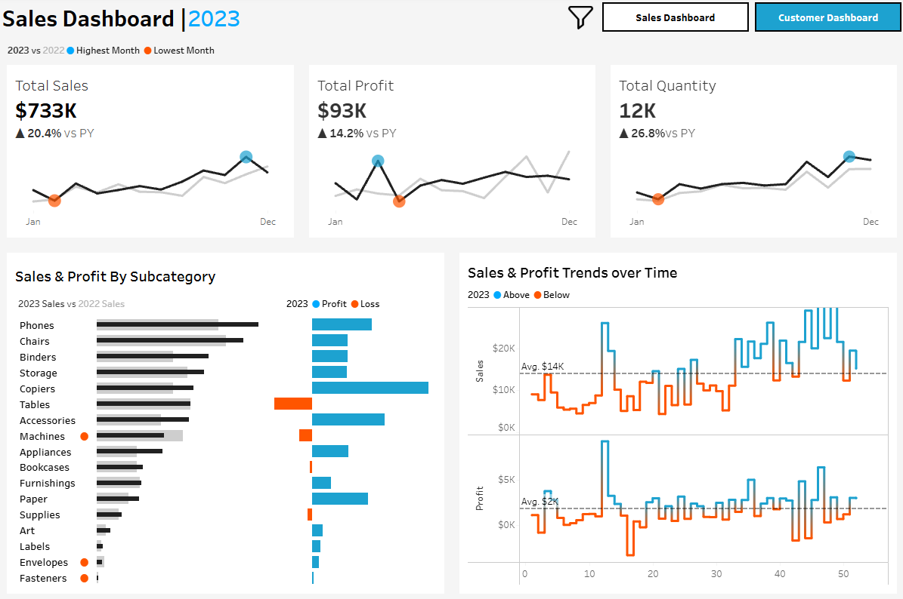
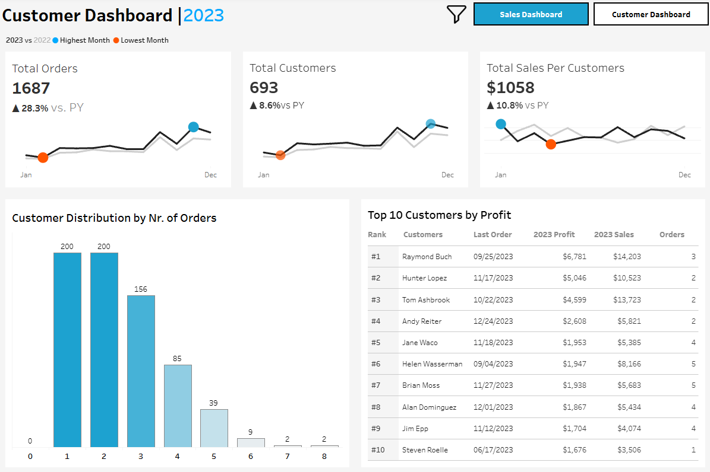

# Tableau Sales & Customer Dashboard

A sales and customer analytics dashboard built in Tableau. The dashboard has two pages, Sales and Customers, and compares each key metric with the previous year.

🔗 **Live dashboard:** [Tableau Public](https://public.tableau.com/views/Customers_Sales_17938370876590/CustomerDashboard?:language=en-US&:sid=&:redirect=auth&:display_count=n&:origin=viz_share_link)

## Features

- **Year parameter** (2020–2023) that controls all current-year (CY) vs. previous-year (PY) calculations, titles, and legends.
- **KPI cards** for Total Sales, Total Profit, Total Quantity, Total Customers, Total Orders, and Sales per Customer, each showing % change vs. PY with ▲/▼ formatting.
- **Monthly trend charts** that compare CY with PY and mark the highest and lowest months (`WINDOW_MAX` / `WINDOW_MIN`).
- **Sales & profit by subcategory**: CY vs. PY bars, profit/loss colors, and a marker for subcategories that sold less than last year.
- **Weekly trends** for sales and profit with an average line; weeks above and below the average are highlighted (`WINDOW_AVG`).
- **Customer metrics**: customer distribution by number of orders (LOD expression) and Top 10 customers by profit with rank, orders, and last order date.
- **Interactivity**: dashboard filter actions, navigation buttons between pages, and a show/hide filter panel (category, subcategory, region, state, city).

## Data model

Four CSV tables connected with Tableau relationships:

| Table | Type | Description |
| --- | --- | --- |
| `Orders` | Fact | Order lines: order/ship dates, ship mode, segment, sales, quantity, discount, profit |
| `Customers` | Dimension | Customer ID and name |
| `Products` | Dimension | Product, category, and subcategory |
| `Location` | Dimension | Postal code, city, state, region, and country |

                          ┌── Products
          Orders ──────────── Location
                          └── Customers
